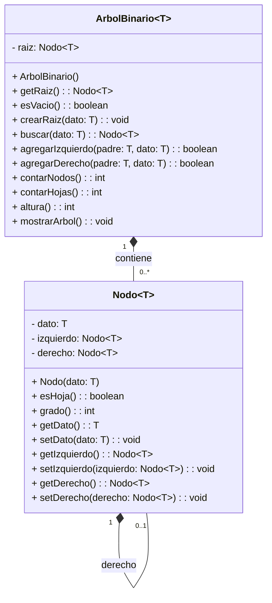

# Implementacion-de-un-Arbol-Binario

**Asignatura:** Estructura de Datos
**Nivel:** Tercero - Ingeniería de Software
**Modalidad:** Individual

## 1. Problema

La Universidad necesita representar la organización de sus dependencias académicas mediante un árbol binario.

Cada nodo almacena el nombre de una dependencia y tiene como máximo dos hijos: izquierdo y derecho.

La aplicación debe permitir construir, visualizar y analizar esta estructura.

## 2. Estructura del Árbol

```
             UNIVERSIDAD
             /         \
       FISEI             DIDE
       /   \             /   \
   SOFTWARE  TI     INVEST.  VINCULACIÓN
    /   \
  NIVEL1 NIVEL3
```

- **Total de nodos:** 9
- **Hojas:** 5 (TI, NIVEL1, NIVEL3, INVEST., VINCULACIÓN)
- **Altura:** 3 aristas
- **Raíz:** UNIVERSIDAD

## 3. Organización del Proyecto

```
src/
 ├── modelo/
 │    └── Nodo.java
 ├── negocio/
 │    └── ArbolBinario.java
 └── app/
      └── Main.java
```

## 4. Diagrama de Clases



## 5. Descripción de las Clases

**Nodo.java**
Guarda el nombre de cada dependencia y sus dos hijos, izquierdo y derecho. Permite saber si es hoja y cuántos hijos tiene con `esHoja()` y `grado()`.

**ArbolBinario.java**
Maneja todo el árbol. Crea la raíz, agrega hijos y calcula con recursividad los nodos, las hojas y la altura. También muestra el árbol en consola.

**Main.java**
Muestra el menú al usuario y usa Scanner para recibir opciones. Llama a los métodos del árbol y presenta los resultados.

## 6. Instrucciones de Ejecución

### En Visual Studio Code:

1. Clonar el repositorio:
```bash
git clone https://github.com/TU-USUARIO/T6-ArbolBinario-ApellidoNombre.git
```

2. Abrir la carpeta en VS Code.

3. Abrir `src/app/Main.java`.

4. Dar clic en **Run** o presionar `F5`.

### En consola:

```bash
cd src
javac modelo/Nodo.java negocio/ArbolBinario.java app/Main.java
java app.Main
```

## 7. Menú

1. Crear árbol inicial
2. Visualizar árbol
3. Consultar número de nodos
4. Consultar número de hojas
5. Consultar altura
6. Consultar grado de un nodo
7. Verificar si un nodo es hoja
8. Salir

## 8. Resultados y Casos de Prueba

| Caso de Prueba | Resultado Esperado | Resultado Obtenido |
| :--- | :--- | :--- |
| Árbol vacío | 0 nodos, altura -1 | ✅ 0 nodos, altura -1 |
| Árbol con un solo nodo | 1 hoja, altura 0 | ✅ 1 hoja, altura 0 |
| Árbol inicial | 9 nodos, 5 hojas, altura 3 | ✅ 9 nodos, 5 hojas, altura 3 |
| Insertar hijo en posición ocupada | Muestra error | ✅ Muestra error |
| Grado de FISEI | 2 | ✅ 2 |
| Grado de SOFTWARE | 2 | ✅ 2 |
| ¿TI es hoja? | Sí | ✅ Sí |
| ¿FISEI es hoja? | No | ✅ No |

### Ejemplo de salida:

```
--- ARBOL ---
└── UNIVERSIDAD
    ├── FISEI
    │   ├── SOFTWARE
    │   │   ├── NIVEL1
    │   │   └── NIVEL3
    │   └── TI
    └── DIDE
        ├── INVEST.
        └── VINCULACIÓN

Numero de nodos: 9
Numero de hojas: 5
Altura (en aristas): 3
Grado de FISEI: 2
Grado de SOFTWARE: 2
```

## 9. Reflexión

**¿Por qué la altura depende del camino más largo desde la raíz hasta una hoja?**
Porque la altura mide la distancia máxima que hay que recorrer. Si se tomara el camino más corto no representaría el tamaño real del árbol.

**¿Diferencia entre lista enlazada y árbol binario?**
En una lista cada nodo tiene un solo siguiente, por lo que la búsqueda es lineal. En un árbol cada nodo tiene dos hijos, lo que permite organizar la información en jerarquía y buscar de forma más eficiente.

**¿Cómo se usaría en SmartETL?**
Un árbol binario podría usarse para organizar y buscar registros de forma jerárquica, por ejemplo por categorías, fechas o códigos, facilitando la búsqueda y clasificación de los datos.

## 10. Restricciones

No se utilizó `TreeSet`, `TreeMap`, `PriorityQueue`, `NavigableSet` ni `NavigableMap`. Las operaciones de conteo y altura se implementaron con recursividad.

